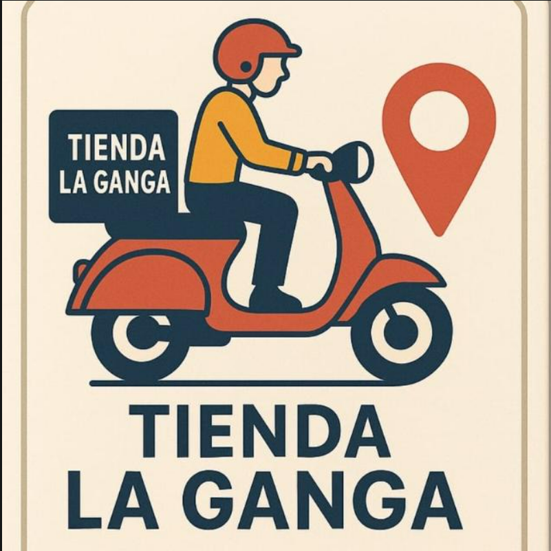

# La Ganga ERP

Sistema comercial para administrar Tienda La Ganga: productos, variantes,
inventario, ventas, cobros, clientes y, en etapas posteriores, compras, caja,
pedidos, entregas y catalogo digital.

El proyecto se encuentra en fase de diseno funcional. No se deben programar
reglas marcadas como **Propuesta** o **Pendiente** hasta que sean confirmadas.

## Documentacion actual

- [Modulo 0 - Fundamentos](docs/00-modulo-fundamentos.md)

## Primer lanzamiento

El primer lanzamiento debe permitir registrar mercaderia, venderla, cobrarla y
consultar existencias y saldos con confianza.

## Tecnologia acordada

- Interfaz: React y TypeScript.
- API: ASP.NET Core 8 Web API.
- Base de datos: PostgreSQL.
- Moneda visible: cordobas (C$).
- Zona horaria de negocio: America/Managua.

