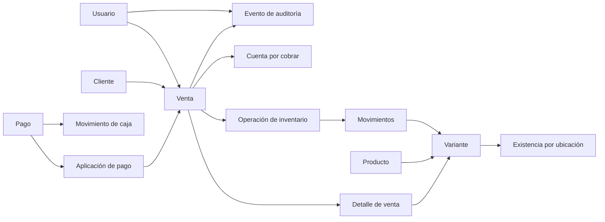

# Módulo 0 — Documentos, auditoría y modelo conceptual de datos

Estado del documento: **Borrador para validación del negocio**  
Alcance: estructura conceptual del primer lanzamiento, todavía sin migraciones ni
código de base de datos.

## 1. Identificadores y números visibles

El ERP utilizará dos identificadores diferentes:

1. **Identificador técnico:** estable, no significativo y utilizado internamente
   por la API y la base de datos.
2. **Número de documento:** código legible que aparece en comprobantes, consultas
   y reportes.

El identificador técnico no debe exponer cantidades, fechas ni información del
negocio. El número visible no se utilizará como llave interna entre tablas.

### 1.1 Reglas obligatorias

- Un borrador tiene identificador técnico, pero no consume un número oficial.
- El número se asigna al confirmar el documento.
- Un número asignado nunca se reutiliza, aunque el documento sea anulado.
- Cada número es único dentro de su tipo y serie.
- La numeración se genera de forma segura en PostgreSQL dentro de la transacción.
- No se obtiene el siguiente número mediante `máximo + 1`.
- La numeración no sustituye la clave de idempotencia que evita dobles registros.
- Una anulación conserva el número del documento original.

### 1.2 Formato propuesto

Formato inicial:

```text
TIPO-UBICACION-CORRELATIVO
```

Ejemplos ilustrativos, no números reales:

```text
VTA-MGA-000001   Venta
PED-MGA-000001   Pedido
COM-MGA-000001   Compra
REC-MGA-000001   Recibo o abono
DEV-MGA-000001   Devolución de cliente
AJU-MGA-000001   Ajuste de inventario
TRS-MGA-000001   Traslado de inventario
CIE-MGA-000001   Cierre de caja
```

Los prefijos, la longitud y el reinicio anual permanecen pendientes de
confirmación. La propuesta técnica es mantener series configurables y no reiniciar
el correlativo, salvo que exista una razón operativa clara.

### 1.3 Código de producto y variante

El número documental no es un código de producto. Se propone:

- Un código interno único por variante.
- Un código de barras opcional por variante.
- Posibilidad de escribir o escanear cualquiera de los dos en el POS.
- El código no cambia si se modifica el nombre comercial del producto.

La estructura y generación de estos códigos continúa pendiente.

## 2. Idempotencia y concurrencia

Las operaciones críticas recibirán una clave de idempotencia generada por el
cliente. El servidor guardará el resultado asociado a esa clave y al usuario o
contexto correspondiente.

Si se repite una solicitud:

- Con la misma clave y los mismos datos, se devuelve el resultado original.
- Con la misma clave y datos diferentes, se rechaza la solicitud.
- Sin una clave válida, una operación crítica no se confirma.

Esto se aplica inicialmente a:

- Confirmación de ventas.
- Registro de pagos y abonos.
- Confirmación de compras.
- Ajustes de inventario.
- Anulaciones y devoluciones.

La idempotencia evita duplicados; el bloqueo o control de concurrencia protege la
última unidad disponible. Son controles distintos y se necesitan ambos.

## 3. Auditoría

### 3.1 Qué debe registrar

Cada evento sensible conservará:

- Usuario responsable.
- Acción realizada.
- Tipo e identificador del registro afectado.
- Fecha y hora del servidor.
- Estado anterior y estado nuevo cuando corresponda.
- Motivo obligatorio para anulaciones, ajustes y excepciones.
- Referencia a la operación o documento relacionado.
- Origen general de la solicitud cuando sea útil para seguridad.

Eventos mínimos:

- Inicio de sesión exitoso y fallido.
- Creación, activación, inactivación y archivo de productos.
- Cambios de precios y costos.
- Confirmación y anulación de ventas.
- Pagos, abonos, reversiones y reembolsos.
- Compras, ajustes, traslados y devoluciones.
- Apertura y cierre de caja.
- Cambios de usuarios, roles, permisos y configuración.
- Accesos rechazados a información sensible.

### 3.2 Protección y privacidad

- La auditoría será de solo adición para los usuarios normales del ERP.
- Una corrección genera un nuevo evento; no sobrescribe el anterior.
- No se guardan contraseñas, tokens, secretos ni datos completos de tarjetas.
- Los teléfonos y direcciones no se copiarán innecesariamente a registros
  técnicos de errores.
- Los datos anteriores y nuevos se limitarán a los campos necesarios para
  explicar el cambio.
- Los registros operativos de auditoría y los registros técnicos de diagnóstico
  se mantendrán separados.
- El acceso a auditoría requerirá permiso administrativo específico.

La duración de conservación y el procedimiento de exportación siguen pendientes.

## 4. Modelo conceptual del primer lanzamiento

### 4.1 Identidad y permisos

| Entidad | Responsabilidad principal |
|---|---|
| Usuario | Cuenta individual, estado y datos de acceso |
| Rol | Perfil reutilizable de trabajo |
| Permiso | Acción concreta autorizable |
| UsuarioRol | Roles asignados a una cuenta |
| RolPermiso | Permisos incluidos en un rol |
| Sesión | Acceso activo y revocable del usuario |

### 4.2 Catálogos y productos

| Entidad | Responsabilidad principal |
|---|---|
| Categoría | Clasificación jerárquica, por ejemplo Dama → Pantalones |
| Marca | Catálogo editable de marcas |
| Corte | Catálogo editable de cortes |
| Talla | Valor textual y grupo opcional de tallas |
| Color | Nombre editable y datos visuales opcionales |
| Producto | Información comercial común de la prenda |
| Variante | Combinación única de producto, talla y color |
| ImagenProducto | Ubicación, orden y descripción de imágenes |

Reglas importantes:

- El valor de talla es texto; `XL` y `1XL` son distintos.
- Categoría admite relación padre-hijo.
- La combinación producto, talla y color es única.
- Los catálogos pueden inactivarse sin alterar registros históricos.
- Producto y variante conservan estado propio.

### 4.3 Inventario

| Entidad | Responsabilidad principal |
|---|---|
| UbicaciónInventario | Tienda, casa o bodega confirmada |
| Existencia | Cantidad actual por variante y ubicación |
| OperaciónInventario | Encabezado y motivo del movimiento |
| MovimientoInventario | Entrada o salida de una variante en una ubicación |

Reglas importantes:

- Existe una sola fila de existencia por variante y ubicación.
- La cantidad es entera y no negativa en la operación normal.
- Todo cambio de existencia tiene un movimiento que lo explica.
- Un movimiento confirmado es inmutable.
- Un traslado crea una salida y una entrada relacionadas dentro de una misma
  operación.

### 4.4 Clientes, ventas y cobros

| Entidad | Responsabilidad principal |
|---|---|
| Cliente | Identidad, teléfono y datos generales |
| DirecciónCliente | Dirección, referencia y ubicación de entrega |
| Venta | Encabezado, totales, cliente y estado documental |
| DetalleVenta | Variante, cantidad y valores históricos de la línea |
| Pago | Dinero recibido, método, fecha y responsable |
| AplicaciónPago | Parte de un pago aplicada a una venta |
| CuentaPorCobrar | Importe original, saldo y estado del crédito |

El detalle de venta guardará una fotografía histórica de la operación:

- Nombre o descripción mostrada al vender.
- Código de variante.
- Talla y color.
- Cantidad.
- Precio unitario.
- Descuento.
- Costo unitario utilizado.
- Total de línea.

Cambiar posteriormente el producto, precio o costo no modifica una venta pasada.

`AplicaciónPago` permite que un pago se distribuya de manera controlada. Para el
primer lanzamiento puede limitarse a una venta por pago, manteniendo la estructura
preparada para ampliar la regla después.

### 4.5 Caja

| Entidad | Responsabilidad principal |
|---|---|
| Caja | Punto lógico donde se controla dinero |
| SesiónCaja | Apertura, responsable, importe inicial y cierre |
| MovimientoCaja | Entrada o salida de dinero con referencia |

Los pagos en efectivo confirmados generan movimientos de caja. Una venta a
crédito genera venta y saldo, pero no una entrada de efectivo por la parte no
cobrada.

### 4.6 Pedidos y entregas

| Entidad | Responsabilidad principal |
|---|---|
| Pedido | Solicitud comercial previa a la venta |
| DetallePedido | Variantes, cantidades y precios propuestos |
| Entrega | Destino, responsable y estado independiente |
| IntentoEntrega | Resultado, fecha, observación y evidencia de cada intento |

Estas entidades pueden implementarse después del primer POS, pero sus relaciones
no deben obligar a rediseñar ventas o clientes.

### 4.7 Auditoría y configuración

| Entidad | Responsabilidad principal |
|---|---|
| EventoAuditoría | Acción trazable realizada sobre el sistema |
| Configuración | Parámetros editables de la tienda |
| SecuenciaDocumento | Serie y siguiente número seguro por tipo de documento |
| SolicitudIdempotente | Clave, operación, resultado y vencimiento técnico |

## 5. Relaciones principales



El diagrama muestra relaciones conceptuales, no nombres definitivos de tablas ni
una migración lista para ejecutar.

## 6. Tipos de datos y precisión

- Cantidades de prendas: números enteros.
- Dinero: decimal con dos posiciones; nunca punto flotante binario.
- Moneda inicial: córdoba nicaragüense, identificada como `NIO` y mostrada como
  `C$`.
- Fechas técnicas: instante consistente del servidor.
- Presentación de fechas: horario de Managua.
- Teléfonos, códigos, tallas y números de documento: texto.
- Estados: valores controlados por la aplicación y la base de datos.

La precisión exacta de costos y cálculos intermedios se definirá antes de crear
las migraciones. Se propone permitir mayor precisión interna para el costo
promedio y redondear únicamente los importes presentados o contabilizados.

## 7. Integridad y eliminación

- No se elimina físicamente un producto, variante, cliente o usuario que tenga
  operaciones relacionadas.
- La inactivación no modifica documentos históricos.
- Las relaciones críticas utilizan restricciones de base de datos, no solo
  validaciones de interfaz.
- Los totales se recalculan y validan en el servidor.
- Las existencias se modifican únicamente mediante el servicio de inventario.
- El saldo se calcula usando ventas, pagos, aplicaciones y reversiones
  confirmadas.

## 8. Flujo de datos de una venta

```text
Interfaz POS
   ↓ solicita disponibilidad
API consulta existencia oficial
   ↓ usuario confirma
API valida permiso, descuento, precio e idempotencia
   ↓ inicia transacción
Bloquea o controla las variantes involucradas
   ↓
Guarda venta + detalles + pago/saldo + movimientos + auditoría
   ↓ confirma transacción
Devuelve número y comprobante de la venta
```

Ningún total, costo, permiso o cantidad enviado por la interfaz se considera
confiable sin validación del servidor.

## 9. Criterios de aceptación

1. Dos ventas confirmadas nunca reciben el mismo número.
2. Un borrador no deja huecos por consumir números oficiales.
3. Anular una venta no permite reutilizar su número.
4. Repetir una solicitud con la misma clave no duplica la operación.
5. Un cambio de precio no modifica detalles de ventas anteriores.
6. Toda cantidad actual de inventario puede explicarse con movimientos.
7. Un usuario inactivo permanece asociado a las acciones que realizó.
8. La auditoría no contiene contraseñas, tokens ni secretos.
9. Un pago modifica cobros y saldo, pero no el valor de las ventas.
10. Las restricciones impiden variantes duplicadas por talla y color.

## 10. Decisiones abiertas de este bloque

| ID | Decisión | Propuesta actual |
|---|---|---|
| DEC-017 | Formato final de números | Prefijo de tipo, ubicación y correlativo |
| DEC-018 | Reinicio anual de series | No reiniciar inicialmente |
| DEC-019 | Código interno de variante | Generarlo y permitir código de barras opcional |
| DEC-020 | Cliente en ventas de contado | Opcional; obligatorio para crédito y entrega |
| DEC-021 | Aplicación de un pago a varias ventas | Preparar el modelo y limitar la interfaz inicial |
| DEC-022 | Retención de auditoría | Definir plazo antes de producción |
| DEC-023 | Precisión interna de costos | Mayor que dos decimales para promedios; confirmar escala |

## 11. Próximo bloque

La arquitectura, organización del repositorio, ambientes y pruebas se encuentran
en [Arquitectura, entornos y estrategia de pruebas](03-arquitectura-entornos-y-pruebas.md).
Con este bloque se cierra la base de diseño del Módulo 0 y se puede entrar al
diseño detallado de Productos e Inventario.
