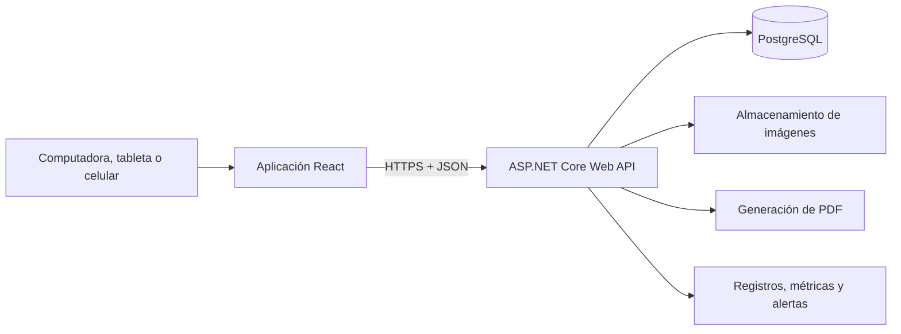

# Módulo 0 — Arquitectura, entornos y estrategia de pruebas

Estado del documento: **Borrador técnico para validación**  
Alcance: arquitectura del primer lanzamiento y preparación del trabajo del
Módulo 1. Este documento no instala dependencias ni crea servicios productivos.

## 1. Objetivo arquitectónico

Construir un ERP confiable y mantenible para una tienda, sin introducir la
complejidad operativa de una plataforma distribuida. El sistema debe permitir
crecer por módulos conservando una sola fuente oficial de datos y transacciones
atómicas para las operaciones críticas.

## 2. Tecnologías acordadas

| Parte | Tecnología |
|---|---|
| Interfaz web | React y TypeScript |
| API y reglas del negocio | ASP.NET Core 8 Web API |
| Persistencia | PostgreSQL |
| Acceso a datos | Entity Framework Core, propuesto |
| Autenticación | JWT en cookies HttpOnly, con protección CSRF |
| Documentos PDF | QuestPDF |
| Contenedores | Docker |
| Imágenes | Cloudinary o Supabase Storage, pendiente |
| Uso móvil | Diseño adaptable; PWA en una etapa posterior |

Las versiones exactas de paquetes se seleccionarán al iniciar la implementación,
utilizando versiones estables y compatibles en ese momento.

## 3. Estilo de arquitectura

Se recomienda un **monolito modular**:

- Una API desplegable.
- Una base de datos PostgreSQL.
- Una aplicación web React.
- Módulos internos con responsabilidades y dependencias explícitas.

No se usarán microservicios en el primer lanzamiento. Separar procesos en varios
servicios aumentaría despliegues, monitoreo, fallos de red y consistencia de datos
sin aportar una ventaja proporcional para la operación actual.

### 3.1 Vista general



La aplicación React presenta información y recoge acciones. La API es responsable
de permisos, precios, descuentos, estados, existencias, saldos y transacciones.

## 4. Módulos internos

| Módulo | Responsabilidad |
|---|---|
| Identidad y acceso | Usuarios, roles, permisos, sesiones y seguridad |
| Catálogo | Productos, variantes, categorías, marcas, tallas, colores e imágenes |
| Inventario | Ubicaciones, existencias, movimientos, ajustes y traslados |
| Ventas | POS, detalles, descuentos, confirmación, anulación y devoluciones |
| Clientes y crédito | Clientes, direcciones, cuentas por cobrar y saldos |
| Pagos y caja | Cobros, abonos, sesiones y movimientos de caja |
| Compras | Proveedores, compras, recepción y costos |
| Pedidos y entregas | Pedidos, asignaciones, intentos y estados de entrega |
| Reportes | Consultas operativas y resultados por período |
| Auditoría y configuración | Historial protegido y parámetros de la tienda |

### 4.1 Regla de dependencia

Un módulo no debe modificar directamente las tablas que pertenecen a otro módulo.
La coordinación se realiza mediante servicios de aplicación dentro de una misma
transacción cuando la operación lo requiere.

Ejemplo: Ventas solicita al módulo de Inventario la salida de las variantes; no
actualiza por su cuenta la columna de existencia.

## 5. Organización propuesta del repositorio

```text
ERP Tienda la Ganga/
├── README.md
├── docs/
├── src/
│   ├── frontend/
│   │   └── la-ganga-web/
│   └── backend/
│       ├── LaGanga.Api/
│       ├── LaGanga.Application/
│       ├── LaGanga.Domain/
│       └── LaGanga.Infrastructure/
├── tests/
│   ├── backend-unit/
│   ├── backend-integration/
│   ├── frontend/
│   └── end-to-end/
├── infrastructure/
│   ├── docker/
│   └── deployment/
└── scripts/
```

Esta estructura es una propuesta. Se creará únicamente al comenzar la
implementación para no llenar el repositorio de carpetas vacías.

### 5.1 Responsabilidades del backend

- **Domain:** entidades, valores y reglas centrales que no dependen de HTTP ni de
  PostgreSQL.
- **Application:** casos de uso, permisos, validaciones y coordinación de
  transacciones.
- **Infrastructure:** Entity Framework Core, almacenamiento de imágenes, PDF y
  servicios externos.
- **Api:** rutas HTTP, autenticación, serialización y composición de la
  aplicación.

Los módulos se organizarán dentro de estas capas sin crear referencias circulares.

### 5.2 Organización del frontend

La interfaz se agrupará por funciones del negocio:

```text
src/
├── app/          configuración, rutas y proveedores
├── features/     productos, inventario, ventas, clientes y demás módulos
├── shared/       componentes y utilidades realmente compartidos
├── api/          cliente generado o tipado para la API
└── styles/       tokens visuales y estilos globales
```

Reglas:

- La interfaz no contiene reglas definitivas de permisos, existencias o dinero.
- Los componentes reutilizables conservan apariencia y comportamiento uniforme.
- Los formularios muestran errores junto al campo correspondiente.
- Las pantallas frecuentes permiten uso táctil y mediante teclado.
- Los filtros se conservan al entrar al detalle y volver al listado.

## 6. Contrato entre interfaz y API

- La API publicará un contrato OpenAPI.
- El frontend utilizará tipos derivados o verificados contra ese contrato.
- Los errores del negocio tendrán códigos estables y mensajes comprensibles.
- Los detalles técnicos se registran en el servidor y no se exponen al usuario.
- Las listas grandes utilizan paginación, orden y filtros del servidor.
- Las fechas viajan en un formato inequívoco y se muestran en horario de Managua.
- Los importes se validan con precisión decimal en el servidor.

La API se versionará cuando exista un cambio incompatible; no se mantendrán
versiones innecesarias durante la etapa inicial.

## 7. Seguridad de aplicación

### 7.1 Sesiones

- Los tokens no se guardan en `localStorage`.
- Las cookies de autenticación serán `HttpOnly`, `Secure` en producción y con una
  política `SameSite` adecuada.
- Las solicitudes que cambian datos tendrán protección CSRF.
- Las sesiones podrán revocarse al desactivar un usuario o ante un evento de
  seguridad.
- Los intentos repetidos de acceso tendrán limitación y registro.
- Los permisos se validan en cada caso de uso del servidor.

La duración de la sesión, renovación y cierre por inactividad permanecen
pendientes de definición.

### 7.2 Secretos y datos sensibles

- Ninguna contraseña, clave de almacenamiento o cadena de producción se guarda en
  Git.
- Los secretos se suministran mediante variables seguras o el servicio de
  secretos del alojamiento.
- Los datos reales de clientes no se copian a desarrollo ni a pruebas.
- Los respaldos se cifran y tienen acceso limitado.
- Los costos y márgenes se excluyen de las respuestas para usuarios no
  autorizados.

## 8. Persistencia y migraciones

- PostgreSQL es la fuente oficial de productos, existencias, ventas y saldos.
- Los cambios de esquema se realizan mediante migraciones versionadas.
- Una migración se prueba con una copia o estructura equivalente antes de
  producción.
- Antes de una migración riesgosa se crea un respaldo verificable.
- La aplicación no modifica automáticamente el esquema productivo al iniciar.
- Los datos iniciales de desarrollo y pruebas nunca se confunden con inventario
  real.
- Las restricciones de unicidad, relaciones y cantidades críticas también se
  aplican en la base de datos.

## 9. Ambientes

### 9.1 Desarrollo local

- Ejecutado por los desarrolladores.
- Base de datos y almacenamiento con datos ficticios.
- Servicios auxiliares iniciados con Docker cuando sea práctico.
- Mensajes de diagnóstico detallados, nunca secretos.

### 9.2 Pruebas automatizadas

- Se crea y destruye de forma controlada.
- Utiliza PostgreSQL real o contenedores temporales para pruebas de integración.
- No comparte base de datos con desarrollo ni producción.

### 9.3 Preproducción

- Configuración similar a producción.
- Datos ficticios o anonimizados.
- Se utiliza para validar migraciones, flujos completos y publicación.
- Su existencia depende del alojamiento elegido, pero se recomienda antes del
  uso con ventas reales.

### 9.4 Producción

- Solo contiene datos reales.
- HTTPS obligatorio.
- Respaldos, monitoreo, alertas y acceso administrativo restringido.
- Publicación controlada y procedimiento documentado de recuperación.

Cada ambiente tendrá base de datos, credenciales y almacenamiento independientes.

## 10. Estrategia de pruebas

### 10.1 Pruebas unitarias

Validarán reglas aisladas, por ejemplo:

- Variantes duplicadas.
- Cálculos de subtotal, descuento y saldo.
- Transiciones de estados.
- Límites de permisos y descuentos.
- Costo promedio cuando sea aprobado.

### 10.2 Pruebas de integración

Utilizarán la API y PostgreSQL real para comprobar:

- Restricciones y migraciones.
- Transacciones atómicas.
- Autorización en el servidor.
- Confirmación y anulación de ventas.
- Movimientos y existencias.
- Pagos y aplicaciones a saldos.
- Idempotencia.
- Concurrencia sobre la última unidad.

### 10.3 Pruebas del frontend

- Formularios, validación y conservación de datos.
- Componentes comunes y estados de carga.
- Navegación por teclado.
- Mensajes de error.
- Diseño adaptable en tamaños representativos.

### 10.4 Pruebas de extremo a extremo

Automatizarán los recorridos de mayor riesgo:

1. Iniciar sesión con permisos diferentes.
2. Registrar un producto con varias variantes.
3. Consultar existencias y filtros combinados.
4. Vender una variante y comprobar su movimiento.
5. Reintentar una venta sin duplicarla.
6. Vender la última unidad desde dos sesiones.
7. Registrar crédito y abono.
8. Anular o devolver conservando trazabilidad.
9. Abrir y cerrar caja cuando el módulo esté disponible.

### 10.5 Pruebas no funcionales

- Accesibilidad básica automatizada y revisión manual.
- Rendimiento de búsquedas, listados e imágenes.
- Seguridad de dependencias y configuración.
- Restauración real de respaldos.
- Compatibilidad con navegadores y dispositivos acordados.

No se considerará suficiente un porcentaje de cobertura aislado. Las pruebas
deben proteger reglas y recorridos que puedan causar pérdida de dinero,
inventario o privacidad.

## 11. Integración y publicación continua

Cada cambio propuesto deberá ejecutar, como mínimo:

1. Formato y análisis estático.
2. Compilación del frontend y backend.
3. Pruebas unitarias.
4. Pruebas de integración relevantes.
5. Comprobación de migraciones.
6. Análisis de dependencias y secretos accidentales.

Las publicaciones de producción utilizarán una versión identificable del código.
El proveedor de integración continua permanece pendiente; GitHub Actions es la
propuesta natural si el repositorio se aloja en GitHub.

## 12. Observabilidad, respaldo y recuperación

### 12.1 Observabilidad

- Registros estructurados con un identificador de operación.
- Comprobaciones de salud de API, base de datos y servicios externos.
- Alertas por fallos repetidos, indisponibilidad y tareas de respaldo.
- Métricas de respuesta y errores sin incluir datos sensibles.
- Auditoría del negocio separada del diagnóstico técnico.

### 12.2 Respaldos

- Copias automáticas de PostgreSQL.
- Política de conservación documentada.
- Protección y copia separada de las imágenes o sus referencias recuperables.
- Prueba periódica de restauración en un ambiente aislado.
- Registro del resultado de cada restauración de prueba.

La frecuencia, conservación y objetivos de recuperación se definirán antes de
producción, según el alojamiento y la tolerancia del negocio a pérdida de datos.

### 12.3 Recuperación de una publicación

- Conservar la versión anterior desplegable.
- Diferenciar reversión de código y reversión de base de datos.
- Evitar migraciones destructivas en una sola publicación cuando sea posible.
- Documentar cómo detener una versión defectuosa sin perder operaciones ya
  confirmadas.

## 13. Plan de implementación del Módulo 1

| Hito | Resultado visible | Límite del trabajo | Validación de cierre |
|---|---|---|---|
| 1. Diseño funcional | Flujos y pantallas de productos e inventario aprobados | Sin código productivo | Campos, estados, permisos y casos de uso revisados |
| 2. Base técnica | Aplicación y API ejecutándose localmente | Sin funciones comerciales completas | Compilación, salud, PostgreSQL y pruebas base funcionan |
| 3. Acceso inicial | Administrador puede iniciar y cerrar sesión | Solo identidad mínima segura | Acceso, rechazo, revocación y permisos probados |
| 4. Catálogos y productos | Crear y editar productos con variantes | Sin ventas ni compras | Unicidad, validación, imágenes y permisos probados |
| 5. Inventario inicial | Registrar y consultar existencias por variante | Entradas iniciales y ajustes autorizados | Kardex explica cada cantidad |
| 6. Experiencia integrada | Listado, filtros y detalle adaptables | Solo alcance del Módulo 1 | Recorrido móvil, teclado, errores y carga validados |
| 7. Preparación de piloto | Módulo documentado y recuperable | Sin declarar producción total | Migraciones, respaldo, restauración y manual comprobados |

Cada hito debe poder verificarse de manera independiente antes de comenzar el
siguiente.

## 14. Definición de terminado

Una función no está terminada solamente porque aparece en pantalla. Debe cumplir:

- Regla del negocio y permisos implementados en el servidor.
- Migración y restricciones necesarias.
- Manejo de carga, éxito y error en la interfaz.
- Pruebas proporcionales al riesgo.
- Auditoría cuando la acción sea sensible.
- Accesibilidad y comportamiento adaptable revisados.
- Documentación actualizada.
- Sin secretos ni datos reales incluidos en el repositorio.

## 15. Decisiones abiertas de arquitectura

| ID | Decisión | Propuesta actual |
|---|---|---|
| DEC-024 | Almacenamiento de imágenes | Elegir Cloudinary o Supabase Storage |
| DEC-025 | Alojamiento de API y PostgreSQL | Evaluar al preparar producción |
| DEC-026 | Integración continua | GitHub Actions si se confirma GitHub |
| DEC-027 | Duración y renovación de sesión | Definir antes de implementar acceso |
| DEC-028 | Navegadores mínimos | Versiones actuales de Chrome, Edge y Safari móvil |
| DEC-029 | Frecuencia y conservación de respaldos | Definir con el alojamiento y riesgo aceptable |
| DEC-030 | Objetivos de recuperación | Definir pérdida máxima de datos y tiempo de recuperación |
| DEC-031 | Funcionamiento sin conexión | No incluido inicialmente; conservar formularios cuando sea seguro |

## 16. Cierre del Módulo 0

Con este documento queda establecida la base de diseño del proyecto. Antes de
implementar se deben confirmar únicamente las decisiones que afecten al bloque que
se vaya a construir. Las demás pueden continuar registradas como pendientes sin
detener el diseño del Módulo 1.
