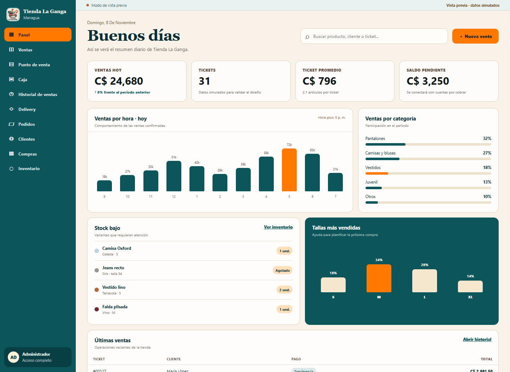
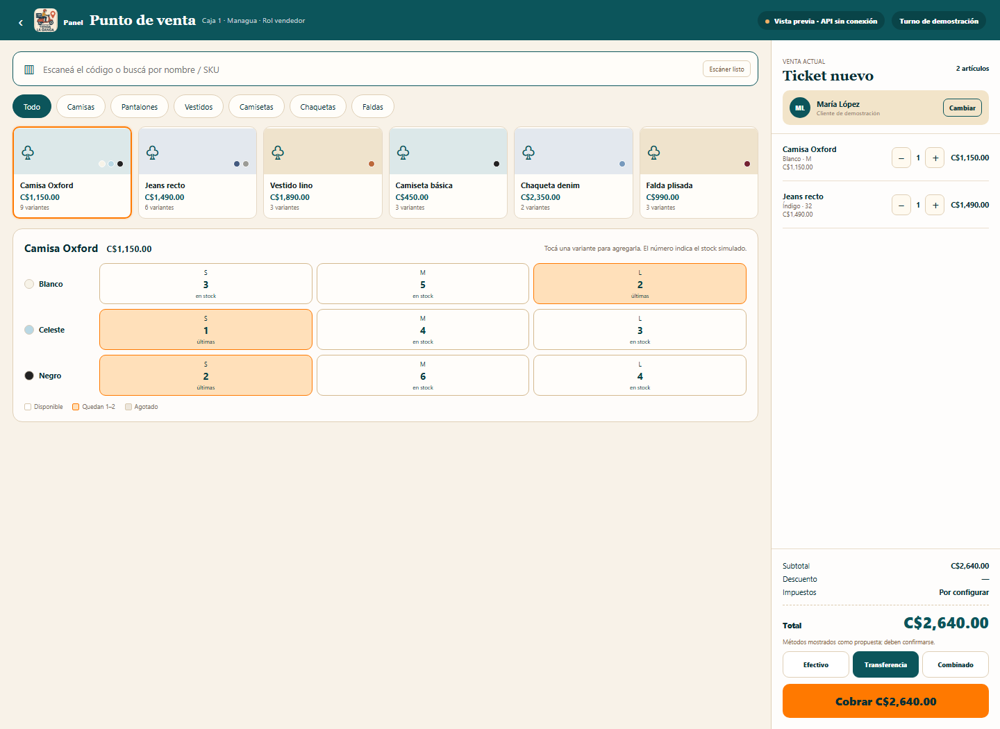
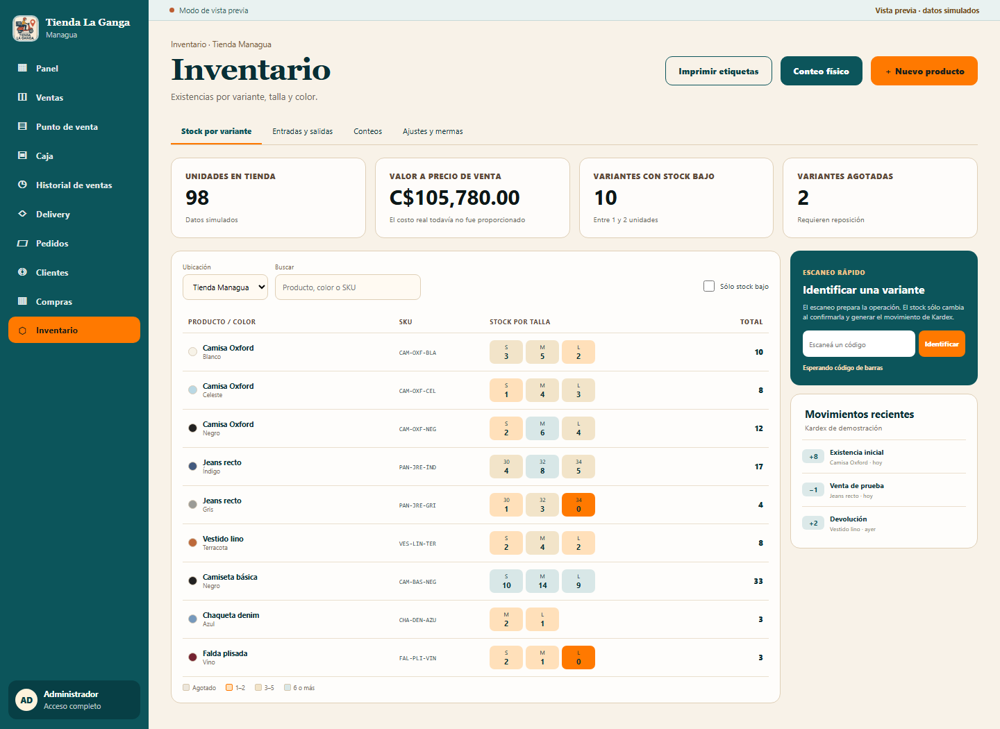
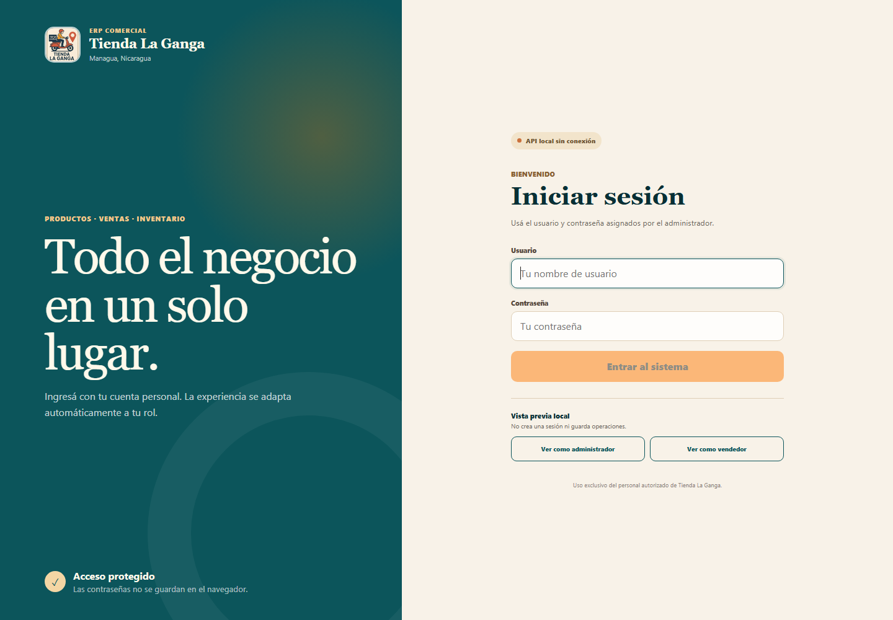
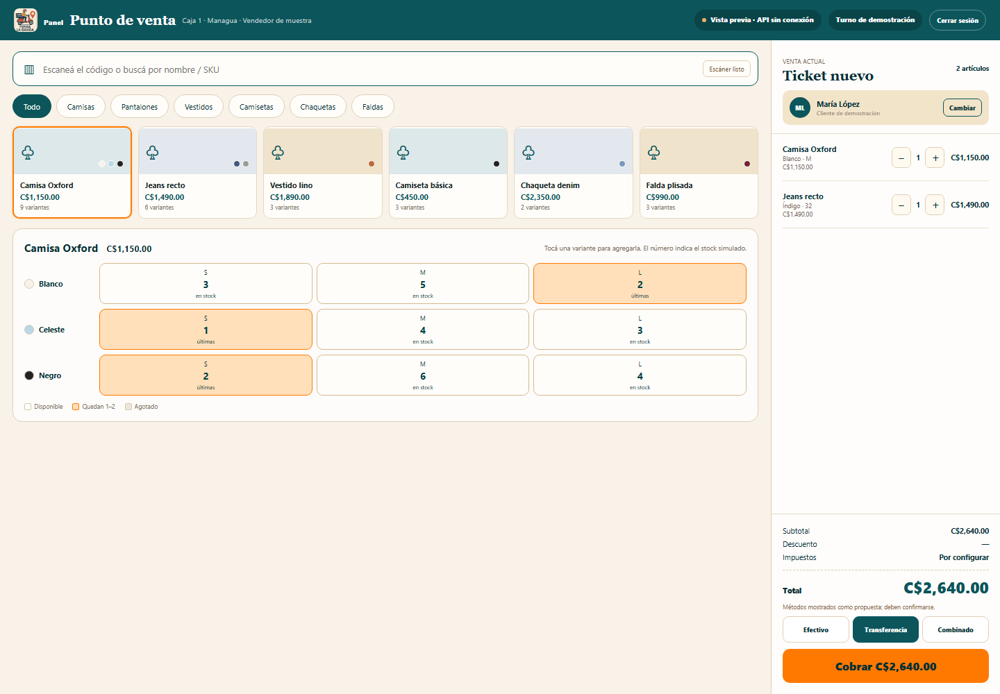
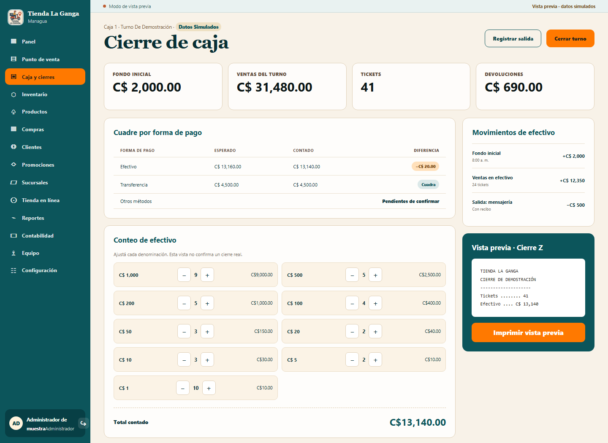
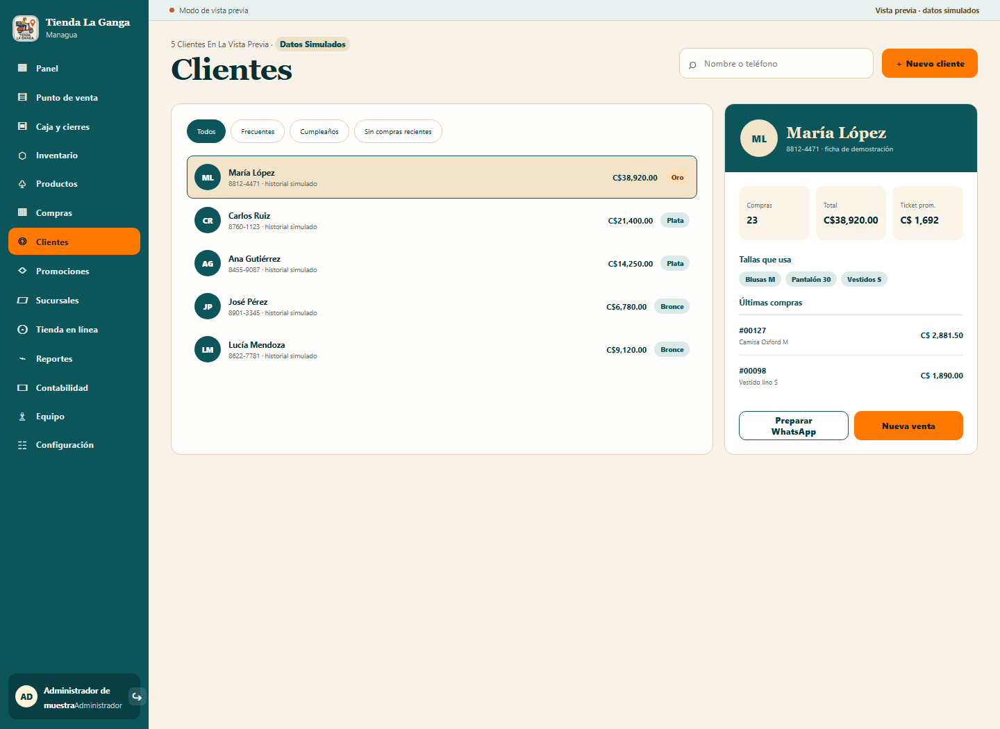
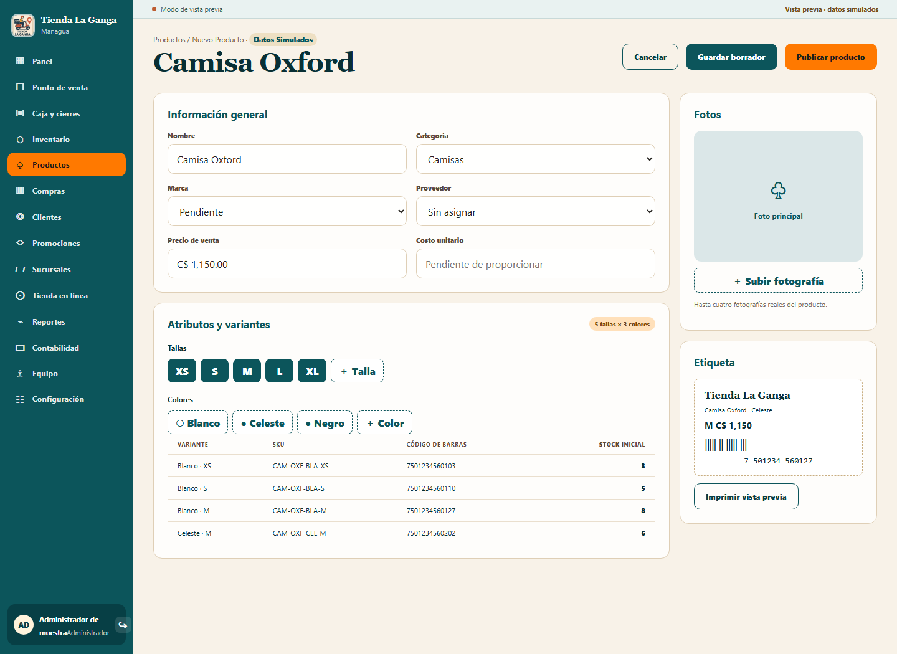
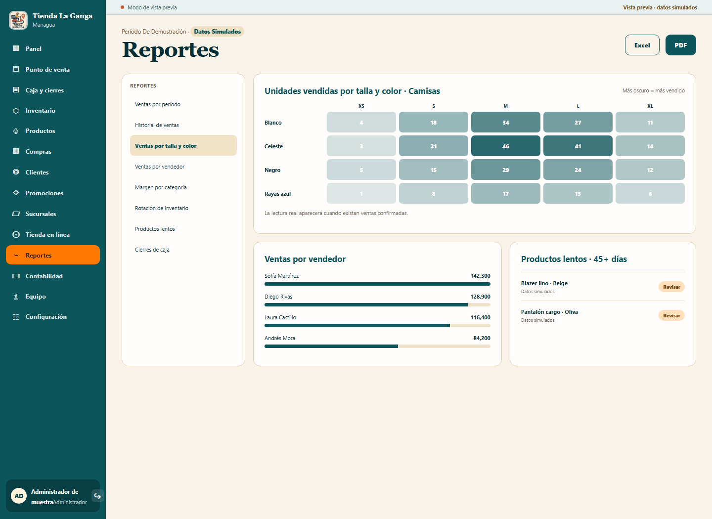

# Sistema visual y pantallas principales

Estado: dirección visual confirmada mediante referencias proporcionadas el 8 de
noviembre de 2026. Los datos visibles en el prototipo son simulados y no deben
cargarse como información real de la tienda.

## Dirección visual

- Navegación administrativa lateral, compacta y persistente en computadora.
- Fondo crema, superficies claras, verde petróleo como color estructural y
  naranja para acciones principales, alertas de pocas existencias y selección.
- Encabezados con tipografía serif y controles con tipografía de interfaz de alta
  legibilidad.
- Tarjetas con bordes suaves, poco relieve y alta densidad sin perder espacio
  táctil.
- Diseño adaptable: el menú se convierte en navegación inferior en pantallas
  pequeñas y el ticket del POS pasa debajo del catálogo.
- Fotografías de productos podrán sustituir los bloques ilustrados cuando estén
  disponibles los archivos reales.

## Navegación del administrador

El menú principal contiene, en este orden:

1. Panel.
2. Punto de venta.
3. Caja y cierres.
4. Inventario.
5. Productos.
6. Compras.
7. Clientes.
8. Promociones.
9. Sucursales.
10. Tienda en línea.
11. Reportes.
12. Contabilidad.
13. Equipo.
14. Configuración.

Esta estructura no elimina requisitos anteriores: Historial de ventas queda
dentro de Reportes; Pedidos y Delivery se gestionan dentro de Tienda en línea;
Ventas se resume en Panel y se consulta en Reportes.

El rol vendedor tendrá acceso directo al punto de venta y únicamente a las
acciones autorizadas para cobrar, consultar disponibilidad y seleccionar un
cliente. Los costos, márgenes y configuración administrativa no se presentan en
esa experiencia.

## Panel administrativo

La portada muestra indicadores, comportamiento de ventas, participación por
categoría, stock bajo, tallas más vendidas y operaciones recientes. Cada cifra
debe provenir de la API y respetar los permisos del usuario. Hasta conectar datos
reales, la interfaz debe identificar de forma visible cualquier información de
demostración.

## Punto de venta

La pantalla prioriza el campo de escaneo, el catálogo, la matriz de variantes y
el ticket. Un código identifica una variante exacta. Un código repetido aumenta
la cantidad sin superar la existencia disponible. Un código desconocido no crea
productos automáticamente.

La pantalla siempre muestra el estado de conexión. El modo sin conexión y la
sincronización se rigen por
[Experiencias por rol y continuidad del POS](04-experiencias-roles-y-modo-offline.md).

Los métodos de pago visibles en el prototipo siguen siendo propuestas pendientes
de confirmación. Tampoco se debe aplicar un impuesto hasta definir la regla
comercial correspondiente.

## Inventario

La vista principal agrupa las existencias por producto, color y talla. Incluye
filtros, alertas, acciones para conteo y etiquetas, escaneo rápido y resumen del
Kardex.

Escanear en inventario sólo identifica o acumula una cantidad dentro de una
operación pendiente. La existencia cambia únicamente al confirmar una entrada,
salida, conteo o ajuste y guardar su movimiento de Kardex.

La única ubicación mostrada inicialmente es **Tienda Managua**. No se añaden
bodegas, casas ni sucursales hasta confirmarlas.

## Alcance del prototipo ejecutable

- Las rutas `#panel`, `#pos` y `#inventario` permiten revisar las tres pantallas.
- El resto de los módulos ya aparece en la navegación y muestra un estado de
  próxima etapa.
- El POS permite elegir variantes, aumentar o reducir cantidades y probar el
  reconocimiento de códigos de demostración del `750100000001` al
  `750100000006`.
- El prototipo no confirma ventas, no persiste cambios y no altera inventario.
- La conexión real de autenticación, permisos, productos, inventario y ventas se
  realizará por módulos sobre la API.

## Vistas adicionales adaptadas

Las referencias posteriores ampliaron el prototipo con Caja y cierres,
Productos, Compras, Clientes, Promociones, Sucursales, Tienda en línea, Reportes,
Contabilidad, Equipo y Configuración. Las pantallas comparten el mismo sistema
visual y son navegables, pero todavía no confirman operaciones ni persisten
información comercial.

Las siguientes reglas visibles en las referencias continúan pendientes y no se
consideran aprobadas: IVA, puntos y fidelización, comisiones, promociones,
crédito, proveedores reales, varias sucursales y métodos de pago definitivos.
