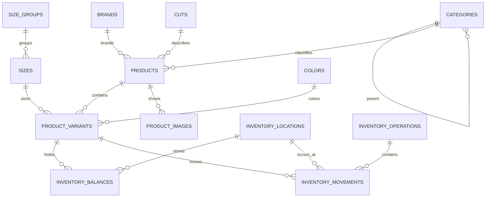

# Módulo 1 — Modelo físico de Productos e Inventario

Estado del documento: **Borrador técnico para validación**  
Motor objetivo: PostgreSQL.  
Alcance: tablas, campos, restricciones, índices y transacciones del Módulo 1. No
es todavía una migración ejecutable.

## 1. Objetivos del modelo

El modelo debe garantizar que:

1. Un producto tenga variantes únicas por talla y color.
2. `XL` y `1XL` permanezcan como valores diferentes.
3. Toda cantidad actual pueda explicarse mediante movimientos.
4. No existan cantidades negativas en la operación normal.
5. Los reintentos no dupliquen productos, existencias ni ajustes.
6. Los registros utilizados por operaciones no se eliminen físicamente.
7. Los costos no se expongan a usuarios sin permiso.
8. Las escrituras concurrentes mantengan saldos correctos.

## 2. Convenciones generales

### 2.1 Claves

- Las claves primarias serán UUID generados por el servidor o PostgreSQL.
- Los números y códigos visibles no serán claves primarias.
- Las claves foráneas tendrán un índice cuando participen en consultas o filtros.
- Las relaciones históricas utilizarán `RESTRICT`, no eliminación en cascada.

### 2.2 Fechas

- Se utilizará `timestamptz` para instantes del servidor.
- La API enviará y recibirá instantes inequívocos.
- La interfaz mostrará las fechas en horario de Managua.
- Las fechas de negocio importantes tendrán columnas distintas: creación,
  modificación, activación, confirmación y anulación.

### 2.3 Cantidades y dinero

- Unidades de prendas: `integer`.
- Precio de venta: `numeric(18,2)`.
- Costos unitarios y promedios: propuesta `numeric(18,4)`.
- Totales monetarios confirmados: `numeric(18,2)`.
- No se utilizarán tipos de punto flotante para dinero.

La escala de cuatro decimales para costos continúa pendiente de confirmación,
pero evita perder precisión durante promedios ponderados.

### 2.4 Estados

Se propone guardar estados como texto corto con restricciones `CHECK`. El código
utilizará valores controlados; la base rechazará estados desconocidos.

Ejemplos:

```text
DRAFT | ACTIVE | INACTIVE | ARCHIVED
PENDING | CONFIRMED | REVERSED
```

### 2.5 Concurrencia

Los registros editables incluirán una columna `version bigint`. Cada modificación
incrementará la versión y verificará el valor anterior. Si otra sesión modificó el
registro, la API devolverá un conflicto comprensible en lugar de sobrescribirlo.

Los saldos de inventario utilizarán además bloqueo transaccional al confirmar
movimientos.

## 3. Relación principal



El diagrama omite usuarios, auditoría e idempotencia para mantener legible el
núcleo del módulo. Esas relaciones se incluyen en las tablas correspondientes.

## 4. Catálogos

Todos los catálogos conservarán como mínimo:

- `id uuid`.
- `name varchar(...)`.
- `normalized_name varchar(...)`.
- `is_active boolean`.
- `sort_order integer`.
- `created_at timestamptz`.
- `created_by uuid`.
- `updated_at timestamptz`.
- `updated_by uuid`.
- `version bigint`.

`normalized_name` se generará en el servidor aplicando espacios uniformes y una
comparación estable sin distinguir mayúsculas. No reemplaza el nombre visible.

### 4.1 `categories`

| Campo | Tipo | Regla |
|---|---|---|
| `id` | uuid | Clave primaria |
| `parent_id` | uuid, nullable | FK a `categories`; nulo para raíz |
| `name` | varchar(100) | Obligatorio |
| `normalized_name` | varchar(100) | Obligatorio |
| `is_active` | boolean | Predeterminado verdadero |
| `sort_order` | integer | Mayor o igual a cero |
| Auditoría y versión | varios | Según convención |

Restricciones:

- Nombre normalizado único entre categorías hermanas.
- `parent_id` no puede ser igual a `id`.
- La aplicación y una validación transaccional impiden ciclos de mayor
  profundidad.
- No se puede inactivar silenciosamente una categoría con descendientes activos;
  la acción debe indicar el efecto.

### 4.2 `brands`

| Campo | Tipo | Regla |
|---|---|---|
| `id` | uuid | Clave primaria |
| `name` | varchar(100) | Obligatorio |
| `normalized_name` | varchar(100) | Único |
| `is_active` | boolean | Estado del catálogo |
| Auditoría y versión | varios | Según convención |

`Sin marca`, si se aprueba, será un registro normal controlado, no un valor nulo
con significado especial.

### 4.3 `cuts`

Misma estructura básica de `brands`. La obligatoriedad del corte será una regla
configurable por categoría o del caso de uso, no una propiedad global de la tabla.

### 4.4 `size_groups`

| Campo | Tipo | Regla |
|---|---|---|
| `id` | uuid | Clave primaria |
| `name` | varchar(100) | Único normalizado |
| `is_active` | boolean | Estado |
| `sort_order` | integer | Orden visual |
| Auditoría y versión | varios | Según convención |

Ejemplos iniciales: Dama normal, Dama especial, Caballero, Juvenil y Camisas.

### 4.5 `sizes`

| Campo | Tipo | Regla |
|---|---|---|
| `id` | uuid | Clave primaria |
| `size_group_id` | uuid, nullable | FK a `size_groups` |
| `name` | varchar(30) | Valor visible: 15, XL o 1XL |
| `normalized_name` | varchar(30) | Para evitar duplicados |
| `is_active` | boolean | Estado |
| `sort_order` | integer | Orden comercial, no alfabético |
| Auditoría y versión | varios | Según convención |

El tamaño es texto. `XL` y `1XL` generan valores normalizados distintos. Una misma
talla puede pertenecer inicialmente a un grupo; si se requiere compartirla entre
grupos se evaluará una tabla intermedia antes de programar.

### 4.6 `colors`

| Campo | Tipo | Regla |
|---|---|---|
| `id` | uuid | Clave primaria |
| `name` | varchar(60) | Obligatorio |
| `normalized_name` | varchar(60) | Único |
| `swatch_hex` | char(7), nullable | Formato `#RRGGBB` |
| `is_active` | boolean | Estado |
| `sort_order` | integer | Orden visual |
| Auditoría y versión | varios | Según convención |

La muestra visual es opcional y nunca sustituye el nombre del color.

## 5. Productos

### 5.1 `products`

| Campo | Tipo | Regla |
|---|---|---|
| `id` | uuid | Clave primaria |
| `name` | varchar(180) | Obligatorio |
| `normalized_name` | varchar(180) | Búsqueda y detección de similares |
| `description` | text, nullable | Descripción comercial |
| `internal_notes` | text, nullable | Solo usuarios autorizados |
| `category_id` | uuid | FK a `categories` |
| `brand_id` | uuid | FK a `brands` |
| `cut_id` | uuid, nullable | FK a `cuts` |
| `default_sale_price` | numeric(18,2) | Mayor que cero para activar |
| `status` | varchar(20) | DRAFT, ACTIVE, INACTIVE, ARCHIVED |
| `activated_at` | timestamptz, nullable | Fecha de activación |
| `archived_at` | timestamptz, nullable | Fecha de archivo |
| `created_at` | timestamptz | Servidor |
| `created_by` | uuid | Usuario |
| `updated_at` | timestamptz | Servidor |
| `updated_by` | uuid | Usuario |
| `version` | bigint | Concurrencia optimista |

Restricciones:

- Precio nulo o cero puede aceptarse en borrador, pero no al activar.
- Un producto activo debe tener categoría, marca confirmada y una variante activa.
- `archived_at` solo tiene valor cuando el estado es ARCHIVED.
- El nombre no será globalmente único: puede haber nombres parecidos de marcas o
  categorías diferentes. La interfaz advertirá coincidencias antes de crear.

### 5.2 `product_variants`

| Campo | Tipo | Regla |
|---|---|---|
| `id` | uuid | Clave primaria |
| `product_id` | uuid | FK a `products` |
| `size_id` | uuid | FK a `sizes` |
| `color_id` | uuid | FK a `colors` |
| `internal_code` | varchar(60), nullable | Único cuando exista |
| `barcode` | varchar(80), nullable | Único cuando exista |
| `sale_price_override` | numeric(18,2), nullable | Mayor que cero |
| `status` | varchar(20) | ACTIVE o INACTIVE |
| Auditoría y versión | varios | Según convención |

Restricciones:

- Única por `(product_id, size_id, color_id)`.
- `internal_code` y `barcode` son únicos con índices parciales que ignoran nulos.
- Una variante con movimientos no se elimina.
- El precio efectivo es la excepción de variante cuando existe; en otro caso, el
  precio predeterminado del producto.

### 5.3 `product_images`

| Campo | Tipo | Regla |
|---|---|---|
| `id` | uuid | Clave primaria |
| `product_id` | uuid | FK a `products` |
| `provider` | varchar(30) | CLOUDINARY o SUPABASE cuando se decida |
| `storage_key` | varchar(500) | Identificador del proveedor, no secreto |
| `secure_url` | text, nullable | URL pública o firmable según proveedor |
| `mime_type` | varchar(100) | Tipo verificado |
| `byte_size` | bigint | Mayor que cero |
| `width` | integer | Mayor que cero |
| `height` | integer | Mayor que cero |
| `alt_text` | varchar(250), nullable | Descripción accesible |
| `position` | smallint | Entre 1 y 4 |
| `status` | varchar(20) | PENDING, READY, FAILED, REMOVED |
| Auditoría y versión | varios | Según convención |

Restricciones:

- Una posición única por producto.
- `position BETWEEN 1 AND 4`, lo que limita el producto a cuatro posiciones.
- Solo imágenes READY participan en la activación y presentación.
- Quitar una imagen marca REMOVED y programa la limpieza segura del proveedor; no
  se pierde inmediatamente la trazabilidad.

## 6. Ubicaciones e inventario

### 6.1 `inventory_locations`

| Campo | Tipo | Regla |
|---|---|---|
| `id` | uuid | Clave primaria |
| `code` | varchar(30) | Único, por ejemplo MGA |
| `name` | varchar(120) | Único normalizado |
| `normalized_name` | varchar(120) | Obligatorio |
| `is_active` | boolean | Estado |
| `is_default` | boolean | Solo una ubicación predeterminada |
| Auditoría y versión | varios | Según convención |

Inicialmente se propone `Tienda Managua`. No se crearán ubicaciones Casa o Bodega
sin confirmación.

### 6.2 `inventory_balances`

| Campo | Tipo | Regla |
|---|---|---|
| `variant_id` | uuid | FK y parte de clave primaria |
| `location_id` | uuid | FK y parte de clave primaria |
| `quantity_on_hand` | integer | Mayor o igual a cero |
| `average_unit_cost` | numeric(18,4), nullable | Solo si se aprueba costo promedio |
| `minimum_quantity` | integer, nullable | Mayor o igual a cero |
| `updated_at` | timestamptz | Último movimiento |
| `version` | bigint | Concurrencia |

La clave primaria compuesta es `(variant_id, location_id)`. Esta tabla es un
saldo rápido y transaccional; no sustituye al historial de movimientos.

`average_unit_cost` y `minimum_quantity` pueden permanecer nulos hasta aprobar sus
reglas. No se inventarán valores iniciales.

### 6.3 `inventory_operations`

Representa el encabezado de una operación que puede contener varios movimientos.

| Campo | Tipo | Regla |
|---|---|---|
| `id` | uuid | Clave primaria |
| `operation_number` | varchar(50), nullable | Se asigna al confirmar |
| `operation_type` | varchar(30) | INITIAL_STOCK, ADJUSTMENT, REVERSAL y futuros |
| `status` | varchar(20) | PENDING, CONFIRMED, REVERSED |
| `reason_code` | varchar(50), nullable | Obligatorio para ajustes |
| `notes` | text, nullable | Observación |
| `source_type` | varchar(50), nullable | Producto, venta, compra u origen futuro |
| `source_id` | uuid, nullable | Identificador del documento relacionado |
| `reverses_operation_id` | uuid, nullable | Operación revertida |
| `idempotency_key` | varchar(100) | Única dentro del alcance definido |
| `confirmed_at` | timestamptz, nullable | Servidor |
| `created_at` | timestamptz | Servidor |
| `created_by` | uuid | Usuario |
| `confirmed_by` | uuid, nullable | Usuario |

Reglas:

- Una operación confirmada no vuelve a PENDING.
- Una reversión crea otra operación y apunta a la original.
- La clave de idempotencia impide confirmar dos veces la misma solicitud.
- `operation_number` es único cuando no es nulo.

### 6.4 `inventory_movements`

| Campo | Tipo | Regla |
|---|---|---|
| `id` | uuid | Clave primaria |
| `operation_id` | uuid | FK a `inventory_operations` |
| `variant_id` | uuid | FK a `product_variants` |
| `location_id` | uuid | FK a `inventory_locations` |
| `quantity_delta` | integer | Distinto de cero; entrada positiva, salida negativa |
| `unit_cost` | numeric(18,4), nullable | Requerido para existencia inicial positiva |
| `balance_after` | integer | Mayor o igual a cero |
| `occurred_at` | timestamptz | Fecha de confirmación del servidor |
| `created_by` | uuid | Usuario responsable |

Restricciones:

- `quantity_delta <> 0`.
- `balance_after >= 0`.
- Un movimiento confirmado es inmutable.
- La combinación operación, variante y ubicación será única cuando la operación
  permita solo una línea por saldo; movimientos futuros que requieran varias
  líneas deberán agregarse antes de guardar.
- Una entrada de existencia inicial requiere costo mayor o igual a cero según la
  política aprobada. La propuesta es exigir costo mayor que cero cuando haya
  unidades.

## 7. Auditoría e idempotencia compartidas

El Módulo 1 utilizará las entidades globales ya definidas:

### 7.1 `audit_events`

Campos mínimos:

- `id uuid`.
- `occurred_at timestamptz`.
- `user_id uuid`.
- `action varchar(80)`.
- `entity_type varchar(80)`.
- `entity_id uuid`.
- `previous_values jsonb`, limitado a campos necesarios.
- `new_values jsonb`, limitado a campos necesarios.
- `reason text`, cuando corresponda.
- `correlation_id uuid`.

No almacenará contraseñas, tokens, claves del proveedor de imágenes ni copias
innecesarias de información personal.

### 7.2 `idempotent_requests`

Campos mínimos:

- `id uuid`.
- `scope varchar(80)`.
- `idempotency_key varchar(100)`.
- `request_hash varchar(128)`.
- `result_type varchar(80)`.
- `result_id uuid`.
- `http_status integer`.
- `created_at timestamptz`.
- `expires_at timestamptz`, según política técnica.

Restricción única: `(scope, idempotency_key)`. La misma clave con otro contenido
se rechaza.

## 8. Índices

### 8.1 Catálogos y productos

- Único por nombre normalizado en marcas, cortes, grupos, tallas y colores según
  su alcance.
- Categorías: índice por `parent_id` y unicidad de nombre entre hermanas.
- Productos: índices por `status`, `category_id`, `brand_id`, `cut_id` y
  `normalized_name`.
- Variantes: único `(product_id, size_id, color_id)`.
- Variantes: únicos parciales por `internal_code` y `barcode` cuando no son nulos.
- Imágenes: único `(product_id, position)` e índice por estado.

Una búsqueda tolerante a fragmentos puede usar `pg_trgm` sobre nombres y códigos,
pero se medirá antes de instalar extensiones. Los filtros exactos usarán índices
B-tree ordinarios.

### 8.2 Inventario

- Saldos: clave primaria `(variant_id, location_id)` e índice alterno por
  `(location_id, quantity_on_hand)`.
- Operaciones: índices por `operation_type`, `status`, `confirmed_at` y origen.
- Movimientos: índice compuesto
  `(variant_id, location_id, occurred_at DESC, id DESC)` para Kardex.
- Movimientos: índice por `operation_id`.
- Idempotencia: único por alcance y clave.

Los índices se validarán mediante planes de ejecución con un volumen de prueba
representativo; no se agregarán índices duplicados sin medir.

## 9. Reglas de eliminación

| Registro | Regla |
|---|---|
| Catálogo sin uso | Puede inactivarse; eliminación física solo antes de uso y con permiso técnico |
| Producto en borrador sin relaciones | Puede descartarse de forma recuperable según política |
| Producto activo o con historial | Se inactiva o archiva; no se elimina |
| Variante con movimientos | Se inactiva; no se elimina |
| Imagen | Se marca removida y se limpia de forma controlada |
| Operación o movimiento confirmado | Nunca se elimina; se revierte |
| Saldo | No se elimina si existen movimientos; puede permanecer en cero |

## 10. Transacción de activación con existencia inicial

Pasos obligatorios:

```text
1. Comprobar idempotencia.
2. Bloquear el producto borrador y verificar su versión.
3. Validar campos, catálogos activos y al menos una variante activa.
4. Validar combinaciones únicas de talla y color.
5. Verificar imágenes listas y máximo cuatro.
6. Crear operación INITIAL_STOCK en estado PENDING.
7. Por cada cantidad positiva:
   a. validar entero y costo;
   b. crear o bloquear el saldo de variante y ubicación;
   c. sumar la cantidad;
   d. guardar movimiento y balance_after.
8. Cambiar producto a ACTIVE.
9. Confirmar la operación y guardar auditoría.
10. Guardar el resultado de idempotencia.
11. Confirmar la transacción.
```

Si cualquiera de estos pasos falla, la transacción se revierte. El producto puede
continuar como borrador, pero no queda activo con inventario parcial.

## 11. Transacción de ajuste

```text
1. Comprobar permiso e idempotencia.
2. Validar variante, ubicación, cantidad y motivo.
3. Iniciar transacción.
4. Bloquear inventory_balances de la variante y ubicación.
5. Calcular el saldo resultante.
6. Rechazar si el resultado es negativo.
7. Crear operación ADJUSTMENT.
8. Actualizar saldo y versión.
9. Crear movimiento con balance_after.
10. Confirmar operación, auditoría e idempotencia.
11. Confirmar la transacción.
```

Dos ajustes simultáneos se serializan sobre el mismo saldo. El segundo utiliza la
cantidad resultante del primero y no una lectura obsoleta.

## 12. Flujo de imágenes

Propuesta independiente del proveedor:

1. La API crea una referencia PENDING y autoriza una carga limitada.
2. El navegador carga directamente al proveedor cuando sea seguro.
3. La API verifica tipo, tamaño, dimensiones y pertenencia al usuario o producto.
4. La referencia cambia a READY.
5. La activación utiliza solamente referencias READY.

La clave privada del proveedor nunca llega al navegador ni al repositorio. Una
carga huérfana se elimina mediante una tarea de limpieza controlada.

## 13. Consultas principales

### 13.1 Listado de productos

- Selecciona datos básicos y fotografía principal.
- Calcula o agrega existencias sin multiplicar filas por cada relación.
- Aplica filtros de talla y color en la misma fila de variante.
- Pagina con orden estable, incluyendo `id` como desempate.
- Proyecta un resultado sin costos cuando el usuario no tiene permiso.

### 13.2 Inventario

- Parte de `inventory_balances` y une producto, variante, talla, color y ubicación.
- Permite filtrar por cantidad, estado y catálogos.
- No utiliza una colección cargada completa en memoria para paginar.

### 13.3 Kardex

- Filtra movimientos por variante, ubicación y rango de fechas.
- Ordena por `occurred_at` e `id` para resultados deterministas.
- Usa `balance_after` para mostrar el saldo confirmado de cada línea.
- Pagina sin perder el orden histórico.

## 14. Seguridad de datos

- La cuenta de la API tendrá solo permisos necesarios sobre su esquema.
- La aplicación separará consultas con costos de consultas sin costos.
- No se confiará en campos ocultos del frontend.
- Los cambios se realizarán mediante casos de uso; no habrá una ruta genérica que
  actualice cualquier columna.
- Las notas internas y costos no se incluirán accidentalmente en modelos públicos.
- Los registros técnicos no copiarán imágenes, secretos ni formularios completos.

## 15. Migraciones propuestas

Orden inicial:

1. Extensiones aprobadas y convenciones generales.
2. Usuarios mínimos requeridos por auditoría, si no existen todavía.
3. Catálogos.
4. Productos, variantes e imágenes.
5. Ubicaciones y saldos.
6. Operaciones y movimientos.
7. Auditoría e idempotencia.
8. Índices adicionales.
9. Datos iniciales de catálogos aprobados.

Las migraciones de datos iniciales serán idempotentes. No incluirán el producto
Monday, costo C$550 ni cantidades demostrativas.

## 16. Pruebas de base de datos

1. Rechazar variante duplicada incluso con dos solicitudes simultáneas.
2. Diferenciar `XL` de `1XL`.
3. Rechazar saldo negativo mediante el caso de uso y restricciones.
4. Reintentar existencia inicial sin duplicar movimientos.
5. Ejecutar dos ajustes concurrentes y conservar saldo correcto.
6. Rechazar una imagen en posición 5.
7. Impedir código interno o código de barras duplicado.
8. Inactivar catálogo sin alterar productos históricos.
9. Revertir toda la activación si falla una línea de inventario.
10. Consultar talla y color sobre la misma variante.
11. Verificar que Kardex y saldo coinciden.
12. Confirmar que las consultas de vendedor no proyectan costos.

## 17. Decisiones abiertas del modelo físico

| ID | Decisión | Propuesta actual |
|---|---|---|
| DEC-048 | Precisión interna del costo | `numeric(18,4)` |
| DEC-049 | Estrategia de estados | Texto corto con restricciones CHECK |
| DEC-050 | Pertenencia de tallas a grupos | Un grupo por talla inicialmente |
| DEC-051 | Costo promedio en el saldo | Columna nullable hasta aprobar la regla |
| DEC-052 | Existencia mínima | Columna nullable por variante y ubicación |
| DEC-053 | Extensión de búsqueda | Evaluar `pg_trgm` con datos representativos |
| DEC-054 | Retención de solicitudes idempotentes | Definir según reintentos y respaldo |
| DEC-055 | Eliminación de borradores abandonados | Política recuperable y plazo pendiente |
| DEC-056 | Costo cero en existencia inicial | Propuesta: rechazar si hay unidades positivas |

## 18. Criterios de cierre

El modelo físico estará listo para migraciones cuando:

- Se confirmen las decisiones que afectan tipos o restricciones.
- Todas las relaciones tengan propietario de módulo claro.
- Los nombres de tablas y campos se revisen con las convenciones del código.
- Las transacciones críticas tengan pruebas de integración diseñadas.
- Se defina el proveedor de imágenes o una abstracción temporal comprobable.
- Se apruebe la política inicial de costos.

## 19. Próximo bloque

Los contratos se encuentran en
[Contratos de API de Productos e Inventario](13-productos-inventario-api.md).
El siguiente bloque consolidará las decisiones que bloquean la implementación y
preparará el backlog técnico del Módulo 1.
